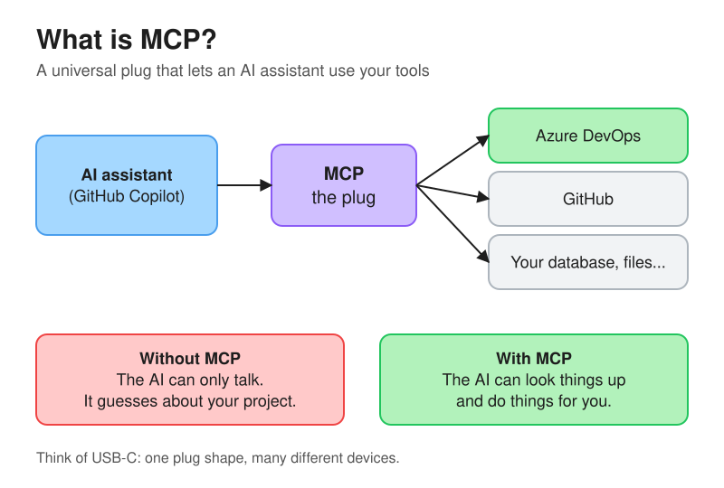
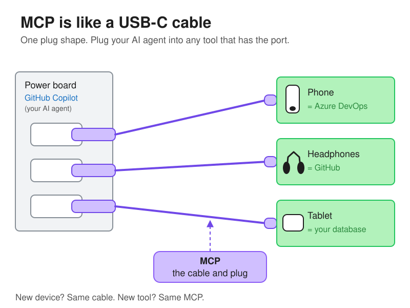
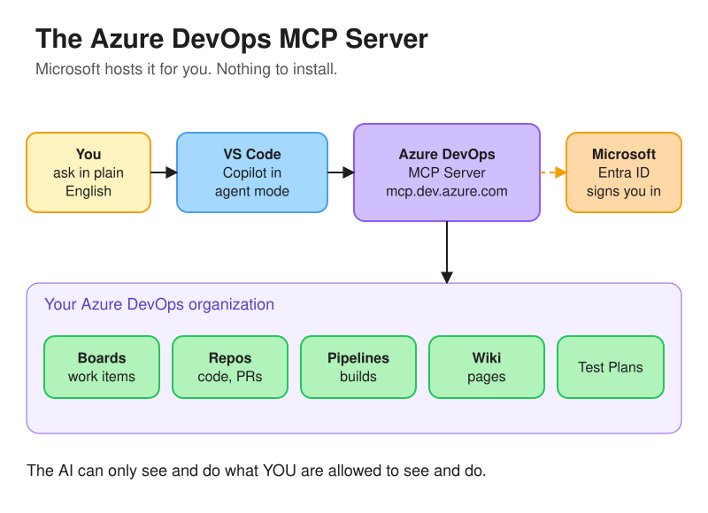
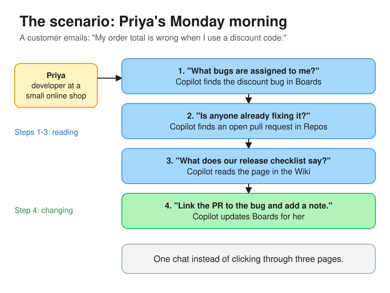
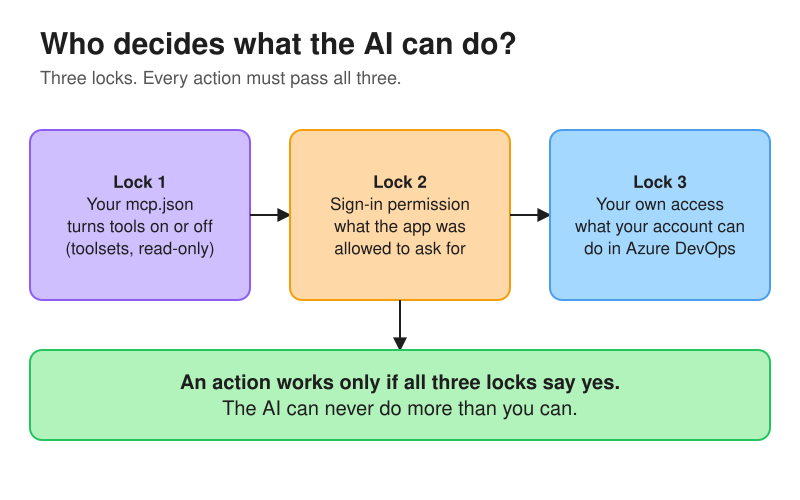

# Lab 1: Azure DevOps MCP Server

Connect GitHub Copilot in VS Code to your Azure DevOps organization, so you can ask about work items, code, pull requests and wiki pages in plain English, and let the AI make changes for you, safely.

| | |
| --- | --- |
| **Time** | About 45 minutes |
| **Cost** | Free. The Azure DevOps MCP Server costs nothing; you only need a GitHub Copilot plan for the chat. |
| **You will build** | A demo Azure DevOps project, an MCP connection from VS Code, and three safety setups (read-only, write, and two-tools-only) |
| **AZ-401 skill** | Design and implement processes and communications → *Configure MCP servers, including Azure DevOps MCP server* |

---

## Contents

1. [The idea in 2 minutes](#1-the-idea-in-2-minutes)
2. [The scenario](#2-the-scenario)
3. [What you need](#3-what-you-need)
4. [Step 1: Get the lab files](#step-1-get-the-lab-files)
5. [Step 2: Install the tools](#step-2-install-the-tools)
6. [Step 3: Check your Azure DevOps organization](#step-3-check-your-azure-devops-organization)
7. [Step 4: Create the lab data](#step-4-create-the-lab-data)
8. [Step 5: Connect VS Code to the MCP server (read-only)](#step-5-connect-vs-code-to-the-mcp-server-read-only)
9. [Step 6: Ask questions (reading)](#step-6-ask-questions-reading)
10. [Step 7: Try to change something in read-only mode](#step-7-try-to-change-something-in-read-only-mode)
11. [Step 8: Turn on writing for work items](#step-8-turn-on-writing-for-work-items)
12. [Step 9: Allow only two tools](#step-9-allow-only-two-tools)
13. [Step 10: Understand the three locks](#step-10-understand-the-three-locks)
14. [Step 11 (optional): The local server](#step-11-optional-the-local-server)
15. [Troubleshooting](#troubleshooting)
16. [Clean up](#clean-up)
17. [Quick check: what you learned](#quick-check-what-you-learned)
18. [References](#references)

---

## 1. The idea in 2 minutes

### What is MCP?



An AI assistant on its own can only **talk**. It doesn't know what's in your Azure DevOps project, so it guesses.

**MCP (Model Context Protocol)** is a standard way to plug an AI assistant into a tool. Think of it like USB-C: one plug shape that works with many devices. Once a tool has an **MCP server**, any AI assistant that speaks MCP can use it, to **look things up** and to **do things**.

Each MCP server offers a list of **tools**. A tool is one action, like "get a work item" or "create a pull request". The AI picks the right tool for your question, calls it, and uses the answer.

### Think of it like charging your devices



| At home | In this lab |
| --- | --- |
| **Power board** on the wall | **GitHub Copilot**, your AI agent. It has the "power" (it can think and talk). |
| **USB-C cable and plug** | **MCP**. One standard plug shape. |
| **Phone, headphones, tablet** | **Azure DevOps, GitHub, a database.** Each tool that has an **MCP server** has the "port". |

You don't buy a new power board for every device. You use the same cable. In the same way, you don't rebuild your AI for every tool: if the tool has an MCP server, you just plug it in.

And just like a cable only charges the devices you actually plug in, the AI can only use the MCP servers **you** connect.

### What is the Azure DevOps MCP Server?



It's the MCP server for Azure DevOps. It gives your AI assistant tools for **Boards, Repos, Pipelines, Wiki, Test Plans** and more.

There are two versions:

| | **Remote server** (we use this) | **Local server** |
| --- | --- | --- |
| Where it runs | Hosted by Microsoft at `mcp.dev.azure.com` | On your own computer |
| Install | Nothing | Node.js 20+ and `npx` |
| How you sign in | Your Microsoft Entra ID account | Entra ID or a personal access token |
| Use it with | VS Code + Copilot, Visual Studio, Copilot CLI, Copilot app, Microsoft Foundry, Copilot Studio | Clients that can't sign in to the remote one, such as Claude Desktop and Codex |

Microsoft recommends the **remote** server whenever your tool supports it.

> **The most important rule:** the AI can only see and do what **you** are already allowed to see and do in Azure DevOps. It never gets extra powers.

---

## 2. The scenario



**Priya** is a developer at a small online shop. On Monday morning a customer emails:

> "My order total is wrong when I use a discount code."

Normally Priya would open Azure Boards to find the bug, then Repos to see if someone is fixing it, then the Wiki to check the release checklist, and finally go back to Boards to link everything together.

In this lab, you are Priya. You'll do all of that from **one chat in VS Code**:

1. "What bugs are assigned to me?" *(reads Boards)*
2. "Is anyone already fixing it?" *(reads Repos)*
3. "What does our release checklist say?" *(reads the Wiki)*
4. "Link the PR to the bug and add a note." *(changes Boards)*

Steps 1 to 3 only **read**. Step 4 **changes** something, and that's where you'll learn to control what the AI is allowed to do.

---

## 3. What you need

| You need | Why | Check |
| --- | --- | --- |
| An **Azure DevOps organization connected to Microsoft Entra ID** | The remote server only works with Entra-backed organizations. Organizations that use a personal Microsoft account (MSA) only are **not supported**. | Step 3 shows how to check |
| Permission to **create a project** in that organization | The setup script creates a demo project | Project Collection Administrator, or the "Create new projects" permission |
| **VS Code** with **GitHub Copilot** | This is the AI assistant | Any Copilot plan, including Copilot Free |
| **Azure CLI** with the **azure-devops** extension | The setup and cleanup scripts use it | Step 2 |
| **Git** | The setup script pushes demo code | Step 2 |
| **A Bash shell** | To run the scripts | macOS and Linux: Terminal. Windows: **Git Bash** (comes with Git for Windows) or WSL |

> **Don't have an organization yet?** Create one at <https://aex.dev.azure.com> while signed in with a **work or school (Entra ID) account**. If you only have a personal account, you can still do the lab with the **local server** in Step 11.

---

## Step 1: Get the lab files

```bash
git clone https://github.com/pratiekbanssal/az401-labs.git
cd az401-labs/lab-01-azure-devops-mcp-server
```

What's inside:

```text
lab-01-azure-devops-mcp-server/
├── README.md                          ← this guide
├── config/
│   ├── 1-read-only.mcp.json           ← Step 5: reading only
│   ├── 2-work-items-write.mcp.json    ← Step 8: reading + writing
│   ├── 3-two-tools-only.mcp.json      ← Step 9: just two tools
│   └── 4-local-server.mcp.json        ← Step 11: local server
├── diagrams/                          ← .excalidraw sources + .svg images
└── scripts/
    ├── setup.sh                       ← creates the lab data
    └── cleanup.sh                     ← deletes it again
```

---

## Step 2: Install the tools

Skip anything you already have.

**Windows** (PowerShell):

```powershell
winget install --id Microsoft.VisualStudioCode -e
winget install --id Git.Git -e
winget install --id Microsoft.AzureCLI -e
```

**macOS** (Homebrew):

```bash
brew install --cask visual-studio-code
brew install git azure-cli
```

**Linux** (Ubuntu/Debian):

```bash
curl -sL https://aka.ms/InstallAzureCLIDeb | sudo bash
sudo apt-get install -y git
# VS Code: https://code.visualstudio.com/download
```

Then, in any terminal:

```bash
# Add the Azure DevOps commands to the Azure CLI
az extension add --name azure-devops

# Check everything is there
az --version
az extension show --name azure-devops --query version -o tsv
git --version
code --version
```

**Install GitHub Copilot in VS Code:**

1. Open VS Code.
2. Open the Extensions view (`Ctrl+Shift+X`, or `Cmd+Shift+X` on macOS).
3. Search for **GitHub Copilot Chat** and select **Install**.
4. Sign in with your GitHub account when asked.

---

## Step 3: Check your Azure DevOps organization

1. Go to `https://dev.azure.com/YOUR_ORG` (replace `YOUR_ORG` with your organization name).
2. Select **Organization settings** (bottom left) → **Microsoft Entra**.
3. You should see **"connected to"** and the name of your Entra directory.

If it says it is **not connected**, the remote MCP server won't work for this organization. Either connect it (an organization owner can do this on the same page) or use the local server in [Step 11](#step-11-optional-the-local-server).

Now sign in to the Azure CLI with **the same account** you use for Azure DevOps:

```bash
az login
```

If you have more than one tenant, add `--tenant YOUR_TENANT_ID` (you can find it on the same **Microsoft Entra** page).

Check who you are signed in as:

```bash
az account show --query user.name -o tsv
```

---

## Step 4: Create the lab data

The MCP server needs something to read. This script builds Priya's world in a new project called **mcp-lab**.

```bash
# Run from the lab-01-azure-devops-mcp-server folder
./scripts/setup.sh YOUR_ORG
```

It takes 1 to 2 minutes and creates:

| What | Details |
| --- | --- |
| Project | `mcp-lab` (Agile process, private) |
| Work items, all assigned to you | Epic **Checkout v2** → 2 User Stories → 2 Tasks, plus **Bug: Order total is wrong when a discount code is used** (priority 1) |
| Repo `mcp-lab` | `README.md` and `order_total.py` (with the bug) on `main` |
| Branch + pull request | `fix/discount-order` with the fix, and an open PR into `main` |
| Wiki | A **Release checklist** page |

At the end the script prints the **bug number** and **PR number**. Note them down.

**Check it worked:** open `https://dev.azure.com/YOUR_ORG/mcp-lab/_boards/workitems` and you should see the six work items.

> On Windows, run the script from **Git Bash**. If you see `Permission denied`, run `bash scripts/setup.sh YOUR_ORG` instead.

---

## Step 5: Connect VS Code to the MCP server (read-only)

We start safe: the AI can **read** but not **change** anything.

### 5.1 Add the config file

VS Code looks for MCP servers in a file called `.vscode/mcp.json` inside the folder you open.

**macOS / Linux / Git Bash:**

```bash
mkdir -p .vscode
cp config/1-read-only.mcp.json .vscode/mcp.json
# Put your organization name into the file
sed -i.bak "s/YOUR_ORG/your-org-name/" .vscode/mcp.json && rm .vscode/mcp.json.bak
```

**Windows PowerShell:**

```powershell
New-Item -ItemType Directory -Force .vscode | Out-Null
(Get-Content config/1-read-only.mcp.json) -replace 'YOUR_ORG','your-org-name' | Set-Content .vscode/mcp.json
```

Your `.vscode/mcp.json` now looks like this:

```json
{
  "servers": {
    "ado-remote-mcp": {
      "url": "https://mcp.dev.azure.com/your-org-name",
      "type": "http",
      "headers": {
        "X-MCP-Toolsets": "repos,wit,wiki",
        "X-MCP-Readonly": "true"
      }
    }
  },
  "inputs": []
}
```

What each line means:

| Setting | Meaning |
| --- | --- |
| `url` | The Microsoft-hosted server, pointed at **your** organization |
| `type: http` | Talk to it over the internet (streamable HTTP), not as a local program |
| `X-MCP-Toolsets` | Only switch on these groups of tools: `repos` (code and PRs), `wit` (work items), `wiki`. Pipelines, test plans and the rest stay **off**. |
| `X-MCP-Readonly` | Only tools that **read**. Every tool that creates or changes something is hidden. |

> `.vscode/` is in this lab's `.gitignore`, so you won't accidentally commit your organization name.

### 5.2 Start the server and sign in

1. Open this folder in VS Code:

    ```bash
    code .
    ```

2. Open the Command Palette (`Ctrl+Shift+P`, or `Cmd+Shift+P` on macOS) and run **Chat: Open Customizations**.
3. Select **MCP Servers**. You'll see **ado-remote-mcp**. Open its **...** menu and select **Start Server**.

    > Older VS Code versions show a small **Start** link above `"ado-remote-mcp"` when you open `.vscode/mcp.json`. That does the same thing.

4. A browser window opens. Sign in with your **Microsoft Entra ID** account (the same one as Azure DevOps) and accept.
5. Back in VS Code, the server shows as **running**.

### 5.3 Open Copilot Chat in agent mode

1. Open the **Chat** view (the chat icon in the title bar, or run **Chat: Open Chat** from the Command Palette).
2. Make sure you're using an **agent** session (the agent picker at the top or bottom of the chat). MCP tools only work in agent mode.
3. Open the tools list: select **Configure Tools** in the chat box, or go to **Chat: Open Customizations → Tools**. Expand **ado-remote-mcp** and look at its tools.

**What you should notice:** you only see **read** tools, such as `wit_work_item`, `repo_pull_request` and `wiki`. There's nothing called `..._write`.

---

## Step 6: Ask questions (reading)

Type each prompt into Copilot Chat (Agent mode). The first time Copilot wants to use a tool, it asks for permission. Select **Allow** (or **Continue**).

> **Tip:** add *"Do not use previously fetched data"* to a prompt if you want Copilot to fetch fresh results.

**Warm-up:**

```text
List the projects in my Azure DevOps organization.
```

You should see `mcp-lab` in the list.

**Scenario prompt 1: find the bug**

```text
In the mcp-lab project, what bugs are assigned to me? Show the ID, title and priority.
```

Expected: the bug **"Order total is wrong when a discount code is used"**, priority 1.

**Scenario prompt 2: is someone fixing it?**

```text
In the mcp-lab repo, are there any open pull requests that look like they fix that bug?
Show me what the PR changes.
```

Expected: the PR **"Fix order total when a discount is used"** from `fix/discount-order`, and the change to `order_total.py`, where the discount now comes off **before** tax.

**Scenario prompt 3: check the release rules**

```text
Read the "Release checklist" page in the mcp-lab wiki. Based on it, can we release while this bug is still open?
```

Expected: Copilot reads the page, sees "no open priority 1 bugs", and says **no, not yet**.

**Bonus:**

```text
Show me the full work item tree under the "Checkout v2" epic.
```

**What's happening behind the scenes:** for each prompt, Copilot picked a tool (you can expand each tool call in the chat to see its name and input), the MCP server called Azure DevOps **as you**, and Copilot turned the answer into plain English.

---

## Step 7: Try to change something in read-only mode

Now ask for a change:

```text
Link pull request <PR number> to bug <bug number> in mcp-lab, and add a comment on the bug:
"Fix is in review. Do not release until this PR is merged."
```

**Expected:** Copilot **cannot** do it. It tells you it has no tool to update or link work items, and may suggest doing it by hand.

That's the read-only header doing its job. The write tools aren't just blocked, they're **not offered to the AI at all**.

---

## Step 8: Turn on writing for work items

Switch to the second config. It drops `X-MCP-Readonly` and keeps only `repos` and `wit`.

**macOS / Linux / Git Bash:**

```bash
cp config/2-work-items-write.mcp.json .vscode/mcp.json
sed -i.bak "s/YOUR_ORG/your-org-name/" .vscode/mcp.json && rm .vscode/mcp.json.bak
```

**Windows PowerShell:**

```powershell
(Get-Content config/2-work-items-write.mcp.json) -replace 'YOUR_ORG','your-org-name' | Set-Content .vscode/mcp.json
```

```json
{
  "servers": {
    "ado-remote-mcp": {
      "url": "https://mcp.dev.azure.com/your-org-name",
      "type": "http",
      "headers": {
        "X-MCP-Toolsets": "repos,wit"
      }
    }
  },
  "inputs": []
}
```

**Restart the server:** run **Chat: Open Customizations → MCP Servers**, open the **...** menu on **ado-remote-mcp** and select **Restart Server**. (If it isn't offered, select **Stop Server**, then **Start Server**.) Open the tools list again. You now also see write tools such as `wit_work_item_write`, `wit_work_item_comment_write` and `wit_work_item_link_write`. The `wiki` tools have gone, because `wiki` is no longer in the toolsets.

Run the same prompt as Step 7:

```text
Link pull request <PR number> to bug <bug number> in mcp-lab, and add a comment on the bug:
"Fix is in review. Do not release until this PR is merged."
```

This time Copilot asks for your OK before each **write** tool. Read what it's about to do, then select **Allow**.

**Check it in the browser:** open the bug at `https://dev.azure.com/YOUR_ORG/mcp-lab/_workitems/edit/<bug number>`. You'll see:

- the new **comment** in the Discussion section
- the **pull request** under Development / Links

One more write, to see a child item get created:

```text
Under bug <bug number>, create a child Task called "Add a unit test for discount + tax" and assign it to me.
```

---

## Step 9: Allow only two tools

Toolsets are groups. Sometimes you want something even smaller: **exactly** these tools and nothing else. That's the `X-MCP-Tools` header.

```bash
cp config/3-two-tools-only.mcp.json .vscode/mcp.json
sed -i.bak "s/YOUR_ORG/your-org-name/" .vscode/mcp.json && rm .vscode/mcp.json.bak
```

```powershell
(Get-Content config/3-two-tools-only.mcp.json) -replace 'YOUR_ORG','your-org-name' | Set-Content .vscode/mcp.json
```

```json
{
  "servers": {
    "ado-remote-mcp": {
      "url": "https://mcp.dev.azure.com/your-org-name",
      "type": "http",
      "headers": {
        "X-MCP-Tools": "core_list_projects, wit_work_item"
      }
    }
  },
  "inputs": []
}
```

Restart the server and look at the tools list: only **`core_list_projects`** and **`wit_work_item`**.

Now try:

```text
Show me the open pull requests in mcp-lab.
```

Copilot can't, because there's no repo tool. Then:

```text
Get bug <bug number> from mcp-lab and summarise it.
```

That works, because `wit_work_item` is allowed.

> **Rule:** use `X-MCP-Toolsets` **or** `X-MCP-Tools`, not both in the same config.

All the header options in one place:

| Header | What it does | Example |
| --- | --- | --- |
| `X-MCP-Toolsets` | Turns on whole groups of tools | `repos,wit,wiki` |
| `X-MCP-Tools` | Turns on only the named tools | `core_list_projects, wit_work_item` |
| `X-MCP-Readonly` | Hides every tool that changes something | `true` |
| `X-MCP-Insiders` | Early access to new and changed tools | `true` |

Toolset names: `all` (default), `repos`, `wit`, `wiki`, `pipelines`, `work`, `testplan`, `advsec`, `elm`.

---

## Step 10: Understand the three locks



Whenever the AI tries to do something in Azure DevOps, three things must **all** say yes:

1. **Your `mcp.json`.** The headers decide which tools the AI can even see (Steps 5, 8 and 9).
2. **Sign-in permission.** The app you signed in with (VS Code here) only has the access it was granted. For custom clients you register yourself, such as Claude Code or Cursor, you choose these permissions (OAuth scopes) and should give only what's needed.
3. **Your own Azure DevOps access.** The server acts **as you**. If you can't edit a work item in the browser, the AI can't either.

Turning on a tool in `mcp.json` **never** gives extra permissions. It only decides what the AI is allowed to *try*.

**Good habits:**

- Start with `X-MCP-Readonly: true`. Turn writing on only when you need it.
- Switch on only the toolsets you need.
- Read the tool call before you select **Allow** on anything that writes.

---

## Step 11 (optional): The local server

Use this when your AI client can't sign in to the remote server, for example **Claude Desktop** or **Codex**, or if your organization isn't connected to Entra ID.

You need **Node.js 20 or newer**:

```bash
node --version   # must be v20 or higher
```

Swap the config:

```bash
cp config/4-local-server.mcp.json .vscode/mcp.json
```

```json
{
  "inputs": [
    {
      "id": "ado_org",
      "type": "promptString",
      "description": "Azure DevOps organization name (for example 'contoso')"
    }
  ],
  "servers": {
    "ado-local-mcp": {
      "type": "stdio",
      "command": "npx",
      "args": ["-y", "@azure-devops/mcp", "${input:ado_org}"]
    }
  }
}
```

Start it the same way as before (**Chat: Open Customizations → MCP Servers → ... → Start Server**). VS Code asks for your organization name, downloads the server with `npx`, and runs it **on your computer** (`type: stdio`). A browser window opens for sign-in. Then repeat any prompt from Step 6.

**Remote vs local, in one line:** remote = Microsoft runs it and you just connect; local = you run it yourself, for clients that can't use the remote one.

For other clients (Visual Studio, Copilot CLI, Cursor, Claude Desktop), see the [Azure DevOps MCP Server repository](https://github.com/microsoft/azure-devops-mcp).

---

## Troubleshooting

| Problem | Fix |
| --- | --- |
| Sign-in fails, or "organization not found" | Make sure the organization is connected to Microsoft Entra ID (Step 3) and you signed in with that same account. Personal-account-only organizations don't work with the remote server. |
| "Server not found" | Check the URL is exactly `https://mcp.dev.azure.com/your-org-name`, with no `dev.azure.com` in the middle and no trailing project name. |
| Connection refused | Your network must allow HTTPS to `mcp.dev.azure.com`. Try without VPN, or ask your admin to allow that address. |
| Connected, but no data comes back | You don't have access to that project or item. Open it in the browser with the same account to check. |
| Copilot doesn't use the tools | Use an **agent** chat session, make sure the server is running, and check its tools are switched on in **Configure Tools**. |
| New tools don't show after changing `mcp.json` | **Chat: Open Customizations → MCP Servers → ... → Restart Server** (or Stop, then Start). |
| `setup.sh` fails at `az devops project create` | You need permission to create projects. Ask an organization admin, or use an organization you own. |
| `setup.sh` fails at `git push` | Run `az login` again with the account that has access to the organization, then re-run the script. It's safe to re-run. |
| Old answers keep coming back | Add "Do not use previously fetched data" to your prompt. |

---

## Clean up

Delete the demo project (work items, repo, PR and wiki):

```bash
./scripts/cleanup.sh YOUR_ORG
```

Type `y` to confirm. Then remove the local config:

```bash
rm -rf .vscode
```

```powershell
Remove-Item -Recurse -Force .vscode
```

Nothing else to remove. The remote MCP server is hosted by Microsoft and costs nothing when you're not using it.

---

## Quick check: what you learned

1. You want an AI assistant to read Azure DevOps but never change it. Which header do you set?
2. What's the difference between `X-MCP-Toolsets` and `X-MCP-Tools`?
3. Your Azure DevOps organization uses only personal Microsoft accounts. Which server can you use?
4. You turned on the `wit` toolset with writing allowed. Can the AI now edit work items in a project you can't access?

<details>
<summary>Answers</summary>

1. `X-MCP-Readonly: true`
2. `X-MCP-Toolsets` turns on **groups** of tools; `X-MCP-Tools` turns on **specific named** tools. Use one or the other.
3. The **local** server. The remote server needs an organization connected to Microsoft Entra ID.
4. **No.** The server acts as you, so your own Azure DevOps permissions always apply.

</details>

---

## References

Official Microsoft Learn documentation:

- [Set up the remote Azure DevOps MCP Server](https://learn.microsoft.com/azure/devops/mcp-server/remote-mcp-server?view=azure-devops): config, headers, toolsets, full tool list, supported clients
- [Enable AI assistance with the Azure DevOps MCP Server](https://learn.microsoft.com/azure/devops/mcp-server/mcp-server-overview?view=azure-devops): overview, remote vs local, installing the local server
- [Connect your organization to Microsoft Entra ID](https://learn.microsoft.com/azure/devops/organizations/accounts/connect-organization-to-azure-ad?view=azure-devops)
- [OAuth scopes for Azure DevOps](https://learn.microsoft.com/azure/devops/integrate/get-started/authentication/oauth?view=azure-devops#oauth-scopes)
- [Get started with the Azure DevOps CLI](https://learn.microsoft.com/azure/devops/cli/?view=azure-devops)
- [Add MCP servers in VS Code](https://code.visualstudio.com/docs/copilot/customization/mcp-servers) and [Manage MCP servers in VS Code](https://code.visualstudio.com/docs/agents/run/manage-mcp-servers)
- [AZ-401 study guide](https://learn.microsoft.com/credentials/certifications/resources/study-guides/az-401)

Other:

- [microsoft/azure-devops-mcp on GitHub](https://github.com/microsoft/azure-devops-mcp): local server, client setup guides, example prompts
- [Model Context Protocol](https://modelcontextprotocol.io)

*Last checked against Microsoft Learn: 22 October 2026. The remote server's tool list changes often, so check the first link above for the latest.*
